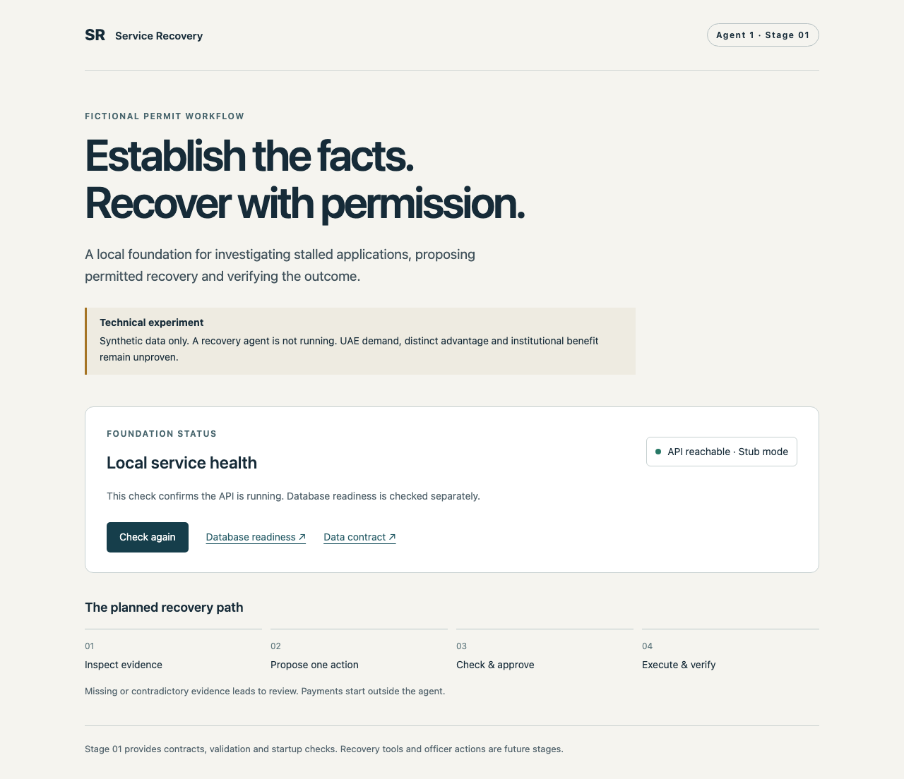
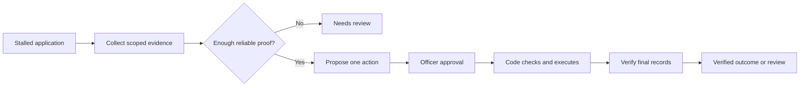

# Service Recovery Agent

**An experimental operations workbench for stalled digital applications.**

When a payment succeeds but its confirmation is lost, an application can remain unfinished. This project explores how an agent could gather reliable evidence, propose only permitted recovery steps, and verify the final result.

> **Status:** **Stage 02 simulator and scoped evidence tools passed local verification on 13 October 2026.** This is a synthetic technical experiment, not a deployed government service or a working recovery agent. Exact UAE demand, meaningful differentiation and institutional benefit remain unproven.

## Local foundation preview

A screenshot of the local foundation. API health is not a verified recovery result.

## Verified development progress

The private implementation now has a PostgreSQL-backed simulator with thirteen seeded failure families. It stores hidden case truth separately from the observations available to an investigator. Six scoped reads expose application, payment, receipt, submission, recent-event and provider-capability evidence. Each result includes source, observation and provider-as-of times, version, outcome/error status and a digest. A delayed receipt can be unknown before it becomes visible; a provider timeout never becomes a payment failure claim.

Four local fault points model interruption before commit, after a simulated external commit, before local acknowledgement and during verification. Seed replay, scope boundaries, and database-role denial of hidden truth/reset were checked against real local PostgreSQL. The full local suite passed **175 Python tests**, including **30 Stage 02 simulator integration cases**, plus schema-drift, lint and frontend production-build checks. These are development tests, not recovery-success or model-performance results. See [the recorded milestone](STATUS.md).

## The first workflow

A fictional permit applicant pays **AED 100**. The payment provider records success, but the portal loses the reply. A service officer needs to establish what happened without charging again or submitting twice.

The proposed workflow checks authoritative payment and receipt records, links the correct receipt if necessary, obtains approval for submission, and independently checks that submission was accepted. Acceptance means receipt of the application, not approval of the permit.

## Boundaries that matter

- Payment starts outside the agent. It cannot initiate, retry, refund or reverse payments.
- The only planned business mutations are **link receipt** and **submit application**.
- A model can request evidence and propose an action. Server-side code owns authorization and validation.
- Approval is bound to one immutable action and expires when relevant facts or permissions change.
- A timeout does not prove failure. Missing or contradictory evidence leads to review.
- Resolution requires a matching successful payment, correct receipt association and independently verified accepted submission.

## AI engineering and deployment foundations

The local foundation uses Python, FastAPI and Pydantic for strict domain contracts; PostgreSQL, SQLAlchemy and Alembic for persistence; and React, TypeScript and Vite for the health interface. Frontend types are generated from the Python schema to reduce contract drift. The simulator adds a narrow evidence gateway, separate observer and evaluator database roles, immutable provenance and repeatable fault injection. These pieces establish an auditable tool boundary for a later model planner; no live model planner has been run yet.

For local deployment engineering, the project has pinned dependencies and lockfiles, database migrations, a readiness endpoint, reproducible startup instructions and a production frontend build. Its verification uses a dedicated local PostgreSQL instance and browser tests. It has not been deployed to a cloud or production service. Later stages propose a shared Temporal executor for both a capable fixed-rule baseline and an adaptive model planner; those recovery components are not implemented. Development remains in clearly labeled stub mode without model credentials.

## What is being tested

The hypothesis is that adaptive evidence selection can improve correct recovery or reduce investigation effort on unfamiliar combinations of failures. The fixed procedure may prove cheaper and more reliable.

A planned paired evaluation will give both approaches the same tools, permissions, budgets and approval schedule. It will measure verified recovery, duplicate effects, wrong receipt links, unauthorized changes, false success reports, unnecessary review, time and cost. Synthetic results will be reported as synthetic, with denominators and uncertainty intervals.

No recovery-performance, savings or production-safety result is claimed. Local verification is recorded in [STATUS.md](STATUS.md).

## Research and originality

This project is being explored in the context of UAE digital services and a possible AI Agents Championship entry. It is not affiliated with or endorsed by a government institution or the championship, and has not been submitted.

- [CyberE71's published challenge](https://hackathon.ae/en/Themes/Digital-Trust?page=1) calls for agent identity, task permissions, intervention and service continuity. It does not establish demand or incident costs for this exact transaction-recovery product.
- [Temporal Activities](https://docs.temporal.io/activities) already provide durable workflow machinery and retries, with application-level idempotency requirements.
- [Agent–tool boundary research](https://arxiv.org/abs/2609.15397) studies external-effect anomalies and the limits of black-box tools.
- [Mnemosyne](https://arxiv.org/html/2607.00269v3) specifies workflow repair and external-effect handling, including paths outside its reported evaluation. Unevaluated prior work still constrains originality.
- [Atomix](https://arxiv.org/abs/2602.14849), [Cordon](https://arxiv.org/abs/2606.17573), [Entra Agent ID](https://learn.microsoft.com/entra/agent-id/authorization-agent-id) and [AgentCore](https://docs.aws.amazon.com/bedrock-agentcore/latest/devguide/policy.html) overlap transactional execution or agent permissions.

**Competition readiness: HOLD.** A verified local simulator does not establish originality, institutional demand or measurable societal value.

## About this repository

This is the **public portfolio and progress repository**. It contains project explanation, architecture and selected verification evidence. Implementation source, local configuration and development materials are kept outside this public repository. It is not an installable source distribution.

Project owner: [Hammad](https://github.com/withhammad). Last updated: 13 October 2026.
